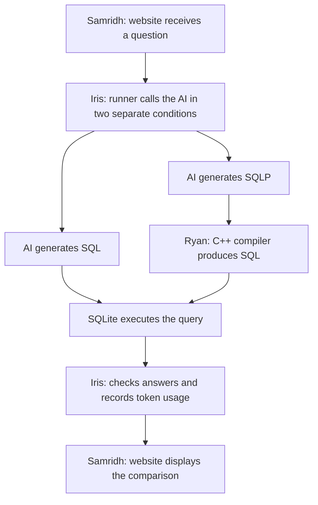

# SQLP for AI Agents in Data Lakes: Correctness and Token Efficiency

Research Question: Given equivalent schema and relationship information, how does using SQLP instead of SQL affect AI agents’ query correctness and total token usage?

## Walkthrough
In the frontend, a client asks "Which researchers at Danish universities have published papers about databases?"

1. **SQL**: agent receives question, schema, approved relationships, and possibly md file containing SQL syntax, then generates SQL.
2. **SQLP**: Same model recieves equivalent information, definitely will need md file with sqlp syntax though, then generates SQLP. Our compiler translates it into SQL.
3. Execute both against the same data.
4. Compare correctness and total tokens.

## Possible Division of Work
| Person | Builds |
|---|---|
| **Ryan** | The C++ compiler that translates SQLP into SQL. |
| **Iris** | The program that calls the AI, executes queries, checks answers, and measures tokens. |
| **Samridh** | Very nice website where someone asks a question and sees the comparison. |

### Sam's Website
- User asks question
- Shows the SQL and SQLP queries that were generated (also shows the SQLP going to SQL when execution engine runs)
  - or instead the user could hover over the SQLP and see what it would translate to for SQL
- If they click on author.university it could show that it connects AUTHOR.university_id = UNIVERSITY.id (basically what we are connecting it on)

### Iris's "Runner"
1. Give the model the question, schema, relationships, and SQL instructions.
2. Receive a SQL query and execute it in SQLite.
3. In a separate run, give the same model equivalent information and SQLP instructions.
4. Receive SQLP, send it to your C++ compiler, then execute the resulting SQL in SQLite.
5. Check both answers against independently prepared expected results.
6. Save the queries, answers, errors, and token usage for Sam to display.

### Ryan
Implemented: path validation, reference lookup, catalog metadata, one-hop path resolution, and SQL rendering from constructed C++ objects.
Planned: text parsing, multi-hop compilation, SQLite execution, the agent experiment runner, and the web interface.

### Diagram
