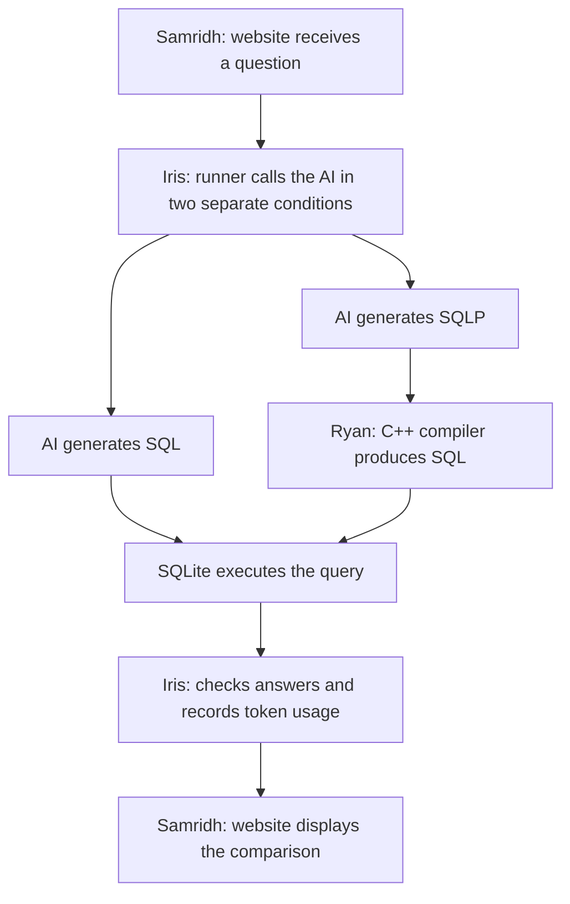

# SQLP for AI Agents in Data Lakes: Correctness and Token Efficiency

Research Question: Given equivalent schema and relationship information, how does using SQLP instead of SQL affect AI agents’ query correctness and total token usage?

Note: [NatSQL](https://github.com/ygan/NatSQL) did do something similar, but our novelty is that we are asking if named paths can help agents select the intended relationship role, and see how correctness changes as paths become longer. Also see whether shorter queries save total tokens. One other route is also is SQLP vs. NatSQL (does SQLP offer something beyond an existing simplified query representation)

Hypothesis: AI is already heavily trained on SQL and not SQLP. SQLP will result in smaller queries but I think the pretraining on SQL will cause it to be slightly less correct and maybe use more tokens as well because it has to think more about it.

## Walkthrough
In the frontend, a client asks "Which researchers at Danish universities have published papers about databases?"

1. **SQL**: agent receives question, schema, approved relationships, and possibly md file containing SQL syntax, then generates SQL.
2. **SQLP**: Same model recieves equivalent information, definitely will need md file with sqlp syntax though, then generates SQLP. Our compiler translates it into SQL.
3. Execute both against the same data.
4. Compare correctness and total tokens.

## Possible Division of Work
| Person | Builds |
|---|---|
| **Ryan** | The C++ compiler that translates SQLP into SQL. |
| **Iris** | The program that calls the AI, executes queries, checks answers, and measures tokens. |
| **Samridh** | Very nice website where someone asks a question and sees the comparison. |

### Sam's Website
- Maybe typescript and react
- User asks question
- Shows the SQL and SQLP queries that were generated (also shows the SQLP going to SQL when execution engine runs)
  - or instead the user could hover over the SQLP and see what it would translate to for SQL
- If they click on author.university it could show that it connects AUTHOR.university_id = UNIVERSITY.id (basically what we are connecting it on)

### Iris's "Runner"
1. Give the model the question, schema, relationships, and SQL instructions.
2. Receive a SQL query and execute it in SQLite.
3. In a separate run, give the same model equivalent information and SQLP instructions.
4. Receive SQLP, send it to your C++ compiler, then execute the resulting SQL in SQLite.
5. Check both answers against independently prepared expected results.
6. Save the queries, answers, errors, and token usage for Sam to display.
**We could also play around with repair opportunities for the agents (ex. rety up to twice)**

## Build and test

### Requirements

- GNU Make.
- A C++20-capable `g++` compiler.

Run these commands from the repository root.

Build and run all tests:

```bash
make test
```

Run the current demo:

```bash
make run
```

Expected demo output:

```text
w.author.name
```

The current executable constructs and prints a path.

## Diagram


## Papers
| Paper | Relevance |
|---|---|
| [The Utility of the Abstract Relational Model and Attribute Paths in SQL](https://pubs.cs.uct.ac.za/id/eprint/1276/1/ersqlpathEKAW18.pdf) | SQLP’s foundations and its evaluation with human users. |
| [NatSQL: Natural SQL](https://aclanthology.org/2021.findings-emnlp.174/) | Closely related work on simplifying the language generated by text-to-SQL models. |
| [SemDisc](https://mirmahathir.com/papers/semdisc.pdf) | Data-lake join-discovery context and potential workloads. Maybe something we try out later. |