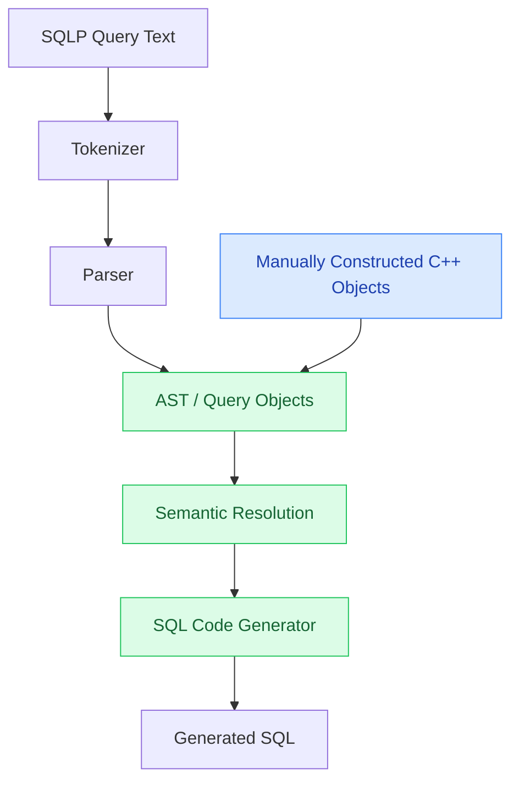

## Notes
- Implemented path validation, reference lookup, and one-hop path resolution.
- Resolved paths contain structured JoinSpec and ColumnRef values.
- Added a catalog recording tables, column types, unique-key declarations, and references.
- Resolution checks that join columns and requested columns exist.
- Generated and tested the complete AUTHOR/PAPER/WROTE SQL query from C++ objects.
- Next: in-memory tables and native C++ query execution.

## Questions
- SQL-P has view based approaches that also make it easier to read. How is ours better/different from that?
- How will we represent information in SQL-P ARM schema like what would our schema be basically as right now for our paths we need some way to know author is associated with that mapping (starting out should I just do it with defined mappings maybe). Enamul in his thesis had buildARM.
- ask for him to go over buildARM syntax I was a bit confused

## Schedule

aiming to have a small native C++ execution prototype working by **October 31**.

### October 19–25
- Add in-memory tables and execute queries directly in C++.
- Implement scans, reference joins, equality filtering, projection, and DISTINCT.
- Test the example's results, empty matches, and duplicate removal before adding text parsing.

### October 26–31

- Add a parser for the small SQLP subset and connect it to the same execution plan.
- Test the full path from query text to results, including invalid input.
- Put together a reproducible demo and document what's supported.

### First prototype

The first version will use the AUTHOR/PAPER/WROTE fixture stored in memory. The scope is one FROM table, one projected path, direct columns or one reference hop, integer/string values, an optional equality filter, and SELECT DISTINCT. References will be explicit, valid, and non-null, pointing to unique keys.

The query I want to demonstrate is:

```sql
SELECT DISTINCT w.author.name AS author_name
FROM WROTE w
WHERE w.paper.title = 'Databases';
```

The expected result is Alice and Bob, with each appearing once and no guaranteed row order. The tests should also check empty results and reject unsupported syntax, unknown names, and type mismatches.

### Longer term

The next major goal is my own B+ tree integrated with the executor: first lookup, insertion, splits, and ranges in memory, then page-based storage, a bounded page cache, and a disk-backed tree. Persistence, deletion, transactions, crash recovery, and broader SQLP support will come after the first execution prototype.

Maybe we could also add in type script for a visualization of how it 

## Planned pipeline

The tokenizer, parser, reusable query objects, and general SQL generator
are planned. Currently, tests construct C++ Path objects directly,
resolve them, and assemble the complete SQL query.
