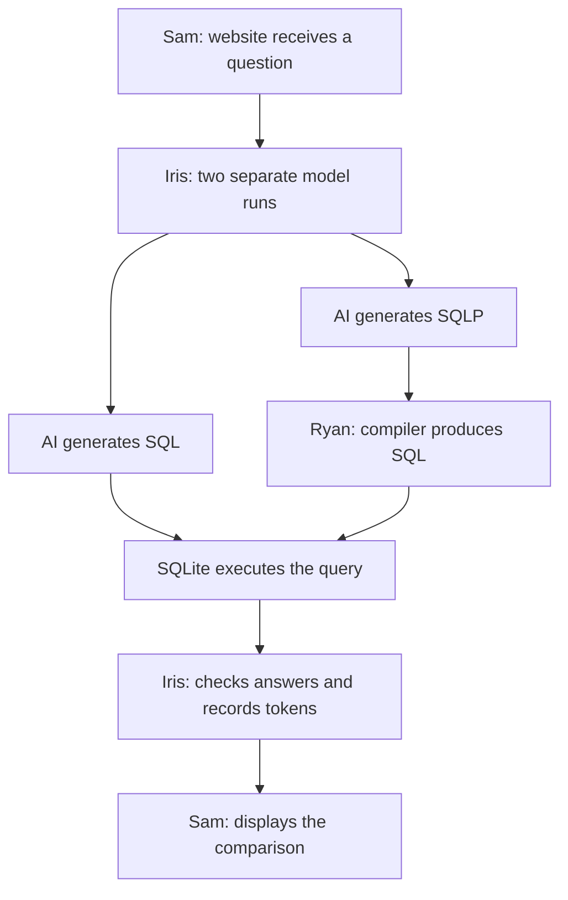

# SQLP for AI Agents: Correctness and Token Efficiency

Current direction · October 26, 2026 · For group review

The idea is to see how using SQLP affects an AI agent's query correctness and token usage. Someone asks a question through our website, and we run the same model separately with SQL and SQLP. We execute both against the same data and compare the answers and total tokens.

**Research question:** Given equivalent schema and relationship information, how does using SQLP instead of SQL affect AI agents' query correctness and total token usage?

I think this gives us a concrete question while keeping the compiler work useful. SQLP could make joins easier to express, but models already know SQL and would need instructions for SQLP. We haven't run the comparison yet, so either approach could perform better.

## What SQLP changes

Suppose we want the authors of recorded papers who work at universities in Denmark. With approved relationships between authorship records, authors, and universities, the model could write:

```sql
SELECT DISTINCT w.author.name
FROM WROTE w
WHERE w.author.university.country = 'DK';
```

Our C++ compiler would translate that into SQL like this, supplying `DK` separately as a parameter:

```sql
SELECT DISTINCT a.name
FROM WROTE AS w
JOIN AUTHOR AS a ON w.author_aid = a.aid
JOIN UNIVERSITY AS u ON a.uni_id = u.uid
WHERE u.country = ?;
```

In the SQL condition, the model writes the joins itself using the same relationship facts. In the SQLP condition, it chooses the path and our compiler constructs the joins. **SQLite executes both.** This example shows the multi-hop behavior we still need to build.

The model still has to choose the right relationship. Following a paper's publisher country instead of its author's university country could produce a valid query with the wrong answer. I think choosing the right relationship role, especially as paths get longer, is an interesting part to test.

## What each of us builds

| Person | Main component |
|---|---|
| **Ryan** | C++ SQLP-to-SQL compiler: parsing, query objects, path resolution, checks, and SQL generation. |
| **Iris** | Runner: model calls, compiler calls, SQLite execution, answer checking, and token/result records. |
| **Samridh** | TypeScript website: question entry, query/answer comparison, and relationship visualization. |

Iris's runner coordinates execution. Sam's website calls it and displays the saved records. Iris and Sam can start with hand-written SQL and example records while I build the text compiler. Question preparation, answer checking, and writing are shared work.



## What the demo would show

Someone chooses a prepared question or enters their own. They see both generated queries, SQLP's translation, the answers, errors, and tokens. Clicking a path could highlight the tables and join columns it uses. That would make it easier to understand where the agents chose different relationships.

Prepared questions have independently checked answers. Arbitrary questions can show results, but remain unscored until we know the correct answer. Agreement between SQL and SQLP alone doesn't prove correctness.

## How we test it

Use the same model/settings, questions, data, and approved relationships. Give each condition a corresponding language guide. Count **all input/output tokens**, including instructions, schema, and any retries. A shorter generated query might still use more total tokens.

Start with first-attempt generation, one model, one reviewed dataset, 12 development questions, and a target of 30 held-out questions. We use development questions to fix the system, then freeze the guides, tested features, and final workload before seeing the held-out outcomes. Equal-budget repairs and another model are possible extensions.

SQLP's human study motivates the question. NatSQL already simplifies queries generated by models, so we should try its existing converter early and include it as a secondary comparison if practical. The required comparison is SQL versus SQLP.

## Scope for this submission

The current C++ code has path/catalog helpers, one-hop resolution, and SQL rendering from constructed objects. We still need the text parser, complete-query compiler, multi-hop support, runner, and website.

We can start with a small collection of related tables in SQLite. A data-lake sample could provide useful questions, but the dataset is still to be chosen. **For now, we supply approved relationships to both agents.** Automatic discovery through something like SemDisc is a possible later extension.

We're aiming for **one working demo and one four-page ICDE demo paper**, reporting what we actually find. See the [shared schedule](SCHEDULES/SCHEDULE.md) and [Ryan](SCHEDULES/Ryan_Schedule.md), [Iris](SCHEDULES/Iris_Schedule.md), and [Sam](SCHEDULES/Sam_Schedule.md) schedules for deliverables. Coding agents should start with [AGENTS.md](AGENTS.md).
